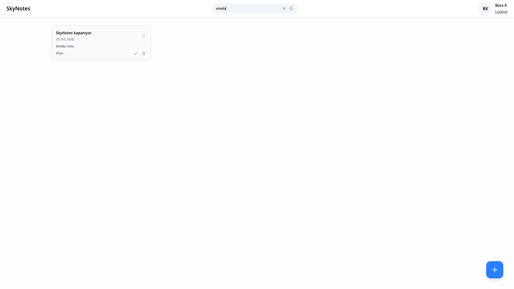

# 📝 SkyNotes: MERN Full Stack Notes Application

This project is a MERN (MongoDB, Express.js, React, Node.js) full-stack web application designed to help you organize and manage your notes.

---

## 🎥 Project Walkthrough (YouTube)

📺 Watch the full development walkthrough and demo in Turkish:
🔗 [Project Video Link](https://youtu.be/cuVuJl7IuXE)

---

## 🌐 Live Demo

🔒 The live demo (skynotes.borak.dev) was shut down in October 2026. Screenshot of the final version:



---

## 🎯 Project Goal

SkyNotes is a minimalist, yet feature-rich MERN stack note-taking application designed to provide users with a seamless experience for organizing their thoughts and ideas.

It focuses on intuitive note management including creation, editing, deletion, and quick access via search and pinning functionalities.

**A primary long-term goal for this project is to integrate with cloud services (e.g., AWS) for robust data synchronization and scalable deployment.**

---

## 🛠️ Technologies Used

### 🔹 Frontend

- React
- React Router DOM
- Tailwind CSS
- React Icons
- Moment.js (for date formatting)

### 🔸 Backend

- Node.js
- Express.js
- Mongoose (MongoDB interactions)
- JSON Web Token (JWT)
- dotenv
- cors
- nodemon (dev server reloading)

### 🗄️ Database

- MongoDB

### 🧪 Other Tools

- Postman (for API testing)

---

## ✨ Features

- 🔐 User Registration and Login (JWT Authentication)
- 📝 Create, Edit, and Delete Notes
- 🔍 Search Notes by Title or Content
- 📌 Pin Notes for Quick Access
- 💬 Responsive Modal Design
- ⚡ Live Search with Debounce
- 📅 Human-Readable Date Format (Moment.js)
- 🔔 Toast Notifications (Create, Edit, Delete)
- 📭 Empty State UI when no notes exist

---

## ⚙️ Installation & Running

**Prerequisites:** Node.js 24 (see `.nvmrc`; use `nvm use` if you use nvm).

### 🔧 Backend Setup

1. Navigate to the `backend` directory.
2. Install dependencies:

```bash
npm install
```

3. Copy `backend/.env.example` to `backend/.env` and fill in the values (at least `ACCESS_TOKEN_SECRET` and `MONGODB_URI`; e.g. your MongoDB Atlas connection string).
4. Start the backend server by running:

```bash
npm start
```

### 🎨 Frontend Setup

1. Navigate to the `frontend` directory.
2. Install dependencies:

```bash
npm install
```

3. (Optional) Copy `frontend/.env.example` to `frontend/.env` to set API URL and dev port.
4. Start the frontend development server:

```bash
npm run dev
```

5. Access the application in your browser:

- Frontend: http://localhost:5174
- Backend: http://localhost:8001

---

## 📚 Additional Information:

- Frontend (in `frontend/`) was created with:
  npm create vite@latest

- Tailwind CSS setup:
  Tailwind Vite Installation Guide

- Font:
  Google Fonts - Noto Sans

- Date formatting with:
  moment → npm i moment

- SVGs used from:
  - https://www.svgrepo.com/vectors/no-note-no-data/
  - https://uxwing.com/no-data-icon/

---

## 🐞Known Issues:

- The 404 error page is not fully customized yet.

---

## 🛠️ Development Process Summary:

- The project was created with React, and pages and components were developed.
- React Router DOM is used for page navigation.
- Styling is done with Tailwind CSS and custom CSS layers.
- Core components such as Navbar, Login screen, Password Input, Search bar, Note Add/Edit Modal, and Tag Input were created.
- A backend API was created using Node.js, Express.js, and Mongoose.
- User and Note models were created.
- Essential API endpoints (user registration, login, note creation, editing, deletion, note retrieval, and note pinning) were developed and connected.
- User information and notes are retrieved from the backend and displayed dynamically.
- **Live search functionality with debouncing was integrated for efficient note filtering.**
- **Note pinning functionality was stabilized to correctly reflect the pinned status visually.**
- **Add/Edit Note modal user experience was improved (responsive design, Escape key closure).**
- Confirmation messages (toasts) have been added for note operations.
- The EmptyCard component is displayed when no notes are found.
- **Addressed and resolved layout issues affecting note card display, particularly during search or with fewer notes.**

## 🚧 Deployment

- **YunoHost:** A GitHub Actions workflow (`.github/workflows/deploy-yunohost.yml`) builds and deploys to a YunoHost server via rsync. See **[docs/DEPLOYMENT-YUNOHOST.md](docs/DEPLOYMENT-YUNOHOST.md)** for setup (Nginx, PM2, SSO, secrets).
- **Elastic Beanstalk:** The workflow `.github/workflows/deploy-backend-to-eb.yml` is currently **temporarily disabled**.

## 🙋 How to Get Support:

If you have any questions or feedback, feel free to:

- 📩 Open an issue on the GitHub repository

- 🤝 Contact me directly via GitHub

**📌 Note:** This README provides a general overview. For more detailed usage, refer to the codebase or open an issue.
